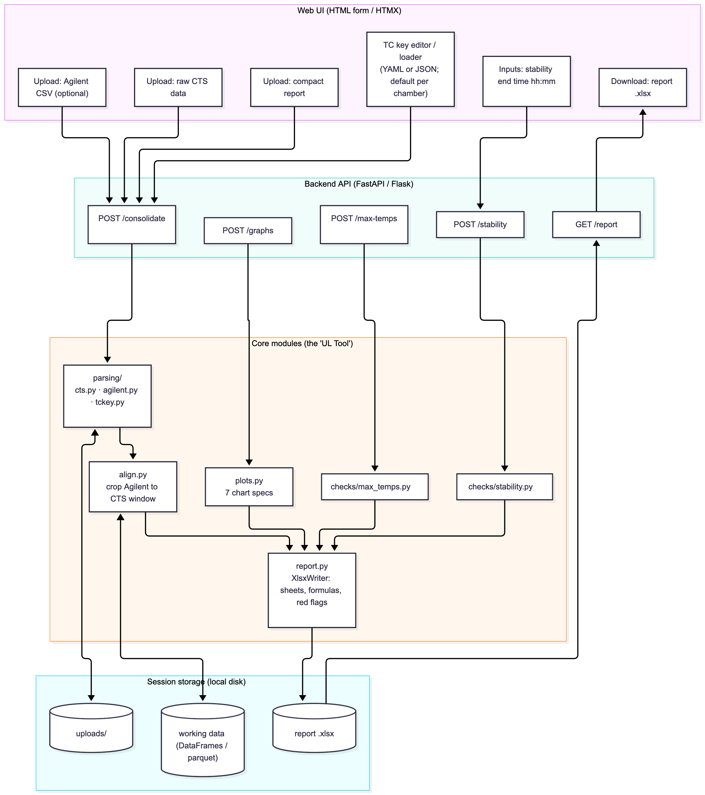
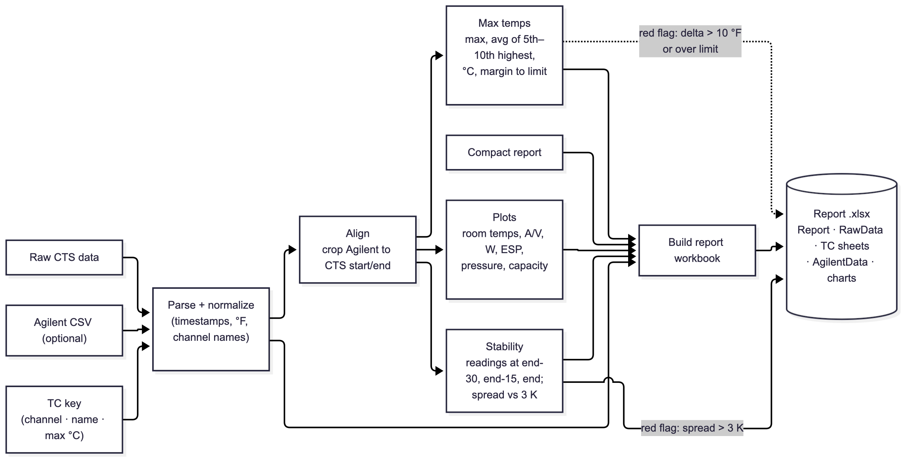

# UL Tool

A locally run web app that automates the UL (Underwriters Laboratory) chamber-test data processing now done by an Excel macro workbook plus manual Excel steps.

> **Status:** Planning / early design. Nothing here is implemented yet. This README describes the intended scope and architecture.

## Why

Today, a technician:
1. Manually crops and aligns the Agilent DAQ data to the CTS report in Excel.
2. Runs macros in `Report_ConsolidatorNEWv40_Kai` to consolidate the report, check max temperatures, check stability, and build graphs.

This project moves those steps into a Python web app that runs locally and produces the same combined Excel report.

## Scope (first release)

Only the macros behind the first four buttons of the `AP4_Instructions` sheet are being ported:

| Button | Macro | Source module | Port target |
|---|---|---|---|
| Consolidate | `ConsolidateReportAP4` | `AP4Checks.bas` | `report.py` |
| Graphs | `createGraphs` | `AP4Graphs.bas` | `plots.py` |
| Check Max Temps | `MaxTempsAP4v2` | `AP4.bas` | `checks/max_temps.py` |
| Check Stability | `CheckStablilityAP4v3` | `AP4.bas` | `checks/stability.py` |

Out of scope for now: the "No Agilent 19.104DV.2" and "No Agilent 19.104DV.3" buttons, plus the Cl 11 and Cl 19 check modules.

## Inputs and outputs

**Inputs**
- Raw CTS chamber data (`.xls` or `.xlsx`)
- Compact report (the CTS summary report)
- Agilent DAQ CSV (optional), e.g. `Scans_1_To_5143_Channels_1001_To_1034.csv`
- TC key: channel number, channel name and max allowed temperature (°C), as YAML/JSON or filled in on an HTML form
- Stability end time (`hh:mm`, or `0` for end of data)

**Output:** one combined Excel report containing:
- `Report`: the compact report
- `RawData`: the raw CTS data
- TC sheet(s) with max-temp and stability results, with red flags
- `AgilentData`: the cropped Agilent data (optional)
- Charts

## Architecture



## Data flow



## Behavior being ported

### Max temps
Runs on CTS data, then on Agilent data if present. For each TC in the key:
- Max temperature (°F)
- Average of the 5th–10th highest readings (°F)
- |Max − average| (°F), flagged **red** if > 10
- Max temperature (°C)
- Allowed max − measured max (°C), flagged **red** if < 0 (blank if no limit is set)

CTS columns are named `Z_UUT_<ID|OD>_TC_<NNN>`. Agilent columns are named `<channel> (F)`.

### Stability
Stability per UL is reached over a 30 minute period.
- Take readings at end − 30 min, end − 15 min and end (°C).
- Spread = max − min across the three readings.
- Spread > **3 K** is flagged **red**.
- End time `0` means "use the last row". Data that crosses midnight prompts for which date to use.

### Agilent alignment
Agilent rows outside the CTS start/end window are removed. Timestamps are matched within the sample interval + 3 s.

### Charts
Smooth XY scatter charts with time on the x-axis:

| Chart | Series |
|---|---|
| ID Room Temps | `PID_PV_ID_DB_TEMP_STS` (primary), `PID_PV_ID_WB_TEMP_STS` (secondary) |
| OD Room Temps | `PID_PV_OD_DB_TEMP_STS` (primary), `PID_PV_OD_WB_TEMP_STS` (secondary) |
| Amps and Volts | `UUT_ID_UNIT_AMPS` (primary), `UUT_ID_UNIT_VOLTS` (secondary) |
| Wattage (W) | `UUT_ID_UNIT_WATTS` |
| ID ESP | `PID_PV_ID_TNL_AIRFLOW_PRESS_STS` |
| ID Pressure | `UUT_REFRIG_PRESS_1001`, `_1002`, `_1003` |
| Indoor Capacity | `ID_TOTAL_`, `ID_SENSIBLE_`, `ID_LATENT_CAPACITY_REPORT` |

The target flowchart also lists OD ESP, OD static pressure, OD capacity, current and an Agilent/CTS DAQ plot. The original macro doesn't build these, so they are new work.

## Known issues in the original macro (fix, don't copy)

- Stability column headers are mislabeled. The "0min" column holds the reading from 30 min before the end, and the "30min" column holds the reading at the end time.
- The OD Room Temps chart is titled "ID Room Temps".
- `GetDataV3` assigns its return value to `GetDataV2`.
- Channel search is limited to 700 columns, and the last row is read as `A1000000`.
- Chart time axis uses column 2, while the checks use column 1.
- The data-start search in `createGraphs` mixes `i` and `channelrow + i`.
- A missing channel column crashes `createGraphs` and is silently skipped by the checks. The app should warn instead.
- TC key lists and raw data can disagree on channels (e.g. 1025 DAQ-card ambient TC). The app should report channels that are in the key but not the data, and the reverse.

## Planned stack

- **Backend:** Python, FastAPI or Flask
- **Data:** pandas
- **Excel in:** `xlrd` (`.xls`), `openpyxl` (`.xlsx`)
- **Excel out:** XlsxWriter (native Excel charts, conditional formatting, live formulas)
- **Frontend:** plain HTML forms with HTMX
- **Config:** YAML/JSON TC keys and chart definitions

## Planned layout

```
ul-tool/
├── app/
│   ├── main.py            # web app and routes
│   ├── parsing/
│   │   ├── cts.py
│   │   ├── agilent.py
│   │   └── tckey.py
│   ├── align.py
│   ├── checks/
│   │   ├── max_temps.py
│   │   └── stability.py
│   ├── plots.py
│   ├── report.py
│   └── templates/         # HTML forms
├── config/
│   ├── tc_keys/           # default per-chamber TC keys
│   └── charts.yaml        # chart definitions
├── tests/
│   └── data/              # sample inputs and reference outputs
└── README.md
```

## Open questions

1. Should the report keep live Excel formulas (as the macro does) or static values?
2. Should the app split alignment/cropping out as its own step (as in the flowchart) or run it inside the tool?
3. Is column 1 or column 2 the correct time axis for the charts?
4. Should the stability headers keep the macro's labels or be corrected?

## Getting started

_Not yet available._

## Validation plan

Use a real finished report (e.g. the `…TEST-A_REVIEWED.xlsx` example) as the reference output. The port should reproduce its max-temp and stability values from the same raw inputs.